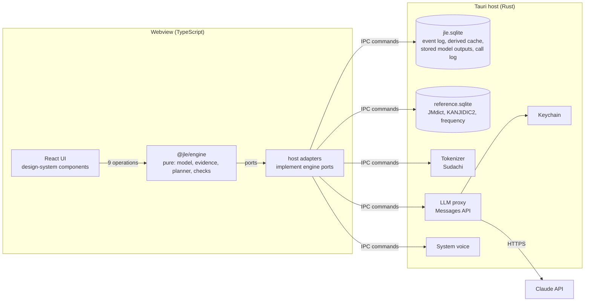
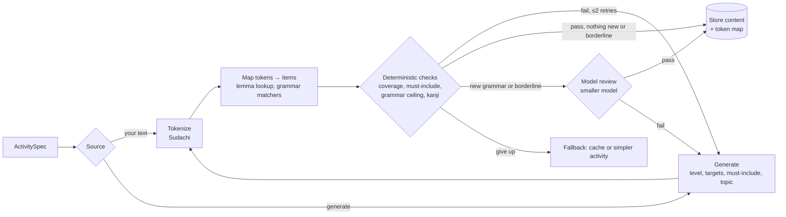

# Japanese Learning Engine — Architecture

Status: draft for review · revised 2026-11-19 for the PRD amendment (items, grammar data, learner content, model use)
Sources: [Japanese Learning Engine — PRD](https://claude.ai/artifact/1J3DyYfFoQAewzP7hDSUtA), the amendment note (wins where they disagree), and the [design system](https://claude.ai/artifact/Dw8bCXfz1Zuxe7jXi71tj4).

The PRD specifies the engine and leaves platform, UI, vendors and sync to the implementer. This doc covers those choices and shows how the PRD's contracts map onto code.

## 1. Decisions taken

| Decision | Choice | Why |
|---|---|---|
| Platform | Tauri 2, React + TypeScript UI | Desktop now. Tauri 2 also builds for iOS and Android from the same code, so mobile is a port, not a rewrite. |
| Engine language | TypeScript, as a pure library | Rules, scoring and state derivation are easy to test in Node. The engine has no I/O of its own, so it runs on desktop, mobile or a server unchanged. |
| Reference data | Full JMdict and KANJIDIC2 in a SQLite reference database. Kana and sound features stay static tables | The dictionary plus a tokenizer covers the whole language at no authoring cost. A fixed word list would cap the tool at one textbook. |
| Learner state | Sparse: a row is created the first time you meet an item | Storage grows with what you have actually seen, not with the dictionary. |
| Grammar | Versioned data files with a schema, approved before use | Grammar is the one part a dictionary can't supply, so adding points is a content task, not a code change. |
| LLM | The Claude API with your own key, called from the Rust host. Used for exactly five jobs (§7) | No backend for one learner. The key stays in the OS keychain. Learner state never lives in the model. |
| Design | The JLE design system: generated tokens, its component CSS, fonts bundled locally | One source for color, type and copy rules. Works offline. |

## 2. Shape of the system



There are three layers, and only the host does I/O:

- **UI** knows nothing about learning rules. It renders an `ActivitySpec` plus content and sends raw interaction events back.
- **Engine** is deterministic. Every effect (clock, ids, event store, catalog, tokenizer, LLM, TTS) comes in through a port. That is what makes replay possible.
- **Host** is thin Rust: two SQLite databases, tokenization, the LLM proxy, keychain and the system voice. Business logic lives only in the engine.

The reference database is read-only and replaceable: a new JMdict release is a new file, never a migration of your learner data.

## 3. Repository layout

```
jle/
  packages/
    engine/          @jle/engine: pure TS
      src/model/     learner state, FSRS wrapper, Bayesian p_known
      src/evidence/  interaction → evidence rules (PRD strength table)
      src/derive/    replay: event log + config + stored outputs → state
      src/planner/   candidates, scoring, strand balance, spec builder
      src/content/   tokenize → map → coverage and grammar checks
      src/grader/    closed-answer matching; LLM finding → item mapping
      src/ports.ts   EventStore, Catalog, Clock, Ids, Tokenizer, Llm, Tts
    reference/       build script: JMdict + KANJIDIC2 + frequency list → reference.sqlite
    grammar/         grammar points as data: schema, ~140 Genki I–II points, matchers, fact sheets
    seed/            static tables (kana, sound features) and test fixtures
  apps/
    desktop/         Tauri 2 app: React UI + src-tauri (Rust host)
  docs/
```

`apps/desktop` holds the only Rust code. A later `apps/mobile` is the same Tauri project with iOS and Android targets turned on.

## 4. The engine

### 4.1 Ports

```ts
interface Ports {
  clock: { now(): Date };
  ids: { next(): string };
  events: EventStore;                  // append-only log
  catalog: Catalog;                    // reference lookups, never a full scan
  tokenizer: { analyze(text: string): Token[] };   // surface, lemma, reading, POS, conjugation
  llm: Llm;                            // one interface, five routes (§7)
  tts: { speak(text: string): Promise<void> };
}

interface Catalog {
  item(id: string): Item | null;
  byLemma(lemma: string, reading?: string): Item[];
  byFrequency(fromRank: number, limit: number): Item[];
  grammar(): GrammarPoint[];           // approved points only
  edgesInto(id: string): ItemEdge[];
}
```

The step-1 engine loads its whole catalog into memory and scans it. That works for 340 items and not for 200k. Step 1b moves every scan behind `Catalog`. Component edges (word → kana, word → kanji) are computed from the reading and written form when asked for, never stored for the whole dictionary.

### 4.2 Operations

The PRD's eight operations plus one:

`startSession`, `nextActivity`, `recordInteraction`, `completeActivity`, `ask`, `getLearnerState`, `overrideItem`, `flagContent`, and **`addContent`**: text you bring (an article, a transcript). It is tokenized, mapped to items and scored for coverage, then offered through the same activities and evidence rules as generated content.

Each operation appends `InteractionEvent`s first, then updates the derived cache through the same reducer that replay uses.

### 4.3 Determinism and replay

State is `derive(eventLog, config, storedOutputs)`:

- No `Date.now()` or `Math.random()` inside the engine.
- Every model output the engine acts on is stored before use: generated content, grader findings, review verdicts, explanations, tutor turns. Replay reads stored outputs and never calls a model.
- `EvidenceEvent`s are derived and stamped with `rulesVersion`. Changing evidence strengths means a rebuild, not a migration.
- Derived tables can be dropped and rebuilt at any time ("Rebuild from log" in Settings).

### 4.4 Learner model

- **Memory:** `ts-fsrs` (FSRS-7), one card per item and skill, target retention 0.90. A miss on something never taught creates no card: it is a measurement, not a failed recall.
- **p_known:** a Beta update weighted by evidence strength, with a prior from placement and prerequisites.
- **Cross-skill:** production evidence counts toward recognition at half weight, never the reverse.
- **Status:** one pure function, tested row by row against the PRD's status table.
- **Sparse rows:** an item with no row reads as Unseen with its prior. A row is written on first evidence or introduction.

### 4.5 Planner

`nextActivity` runs the PRD loop once:

1. Build candidates from the derived cache: due requirements, Learning, uncertain, and frontier items. Frontier items come from `Catalog.byFrequency` and pinned goals, never from a full scan.
2. Set the new-item budget from trailing retention. Words from your own content share this budget: an article with 80 unknown words does not add 80 new items in one sitting.
3. Pick the strand that best restores the seven-day balance.
4. Score activity templates for that strand.
5. Emit an `ActivitySpec`.
6. Get content: the one pre-generated activity if it still matches, else cache, else generate, else a simpler activity.

Within a session an item comes back only for a reason: you missed it (it is taught again: shown, heard, used, then checked once more later, at most twice per session), it is due by FSRS, or it was just introduced and gets one later check. A correct answer means it rests. Placement misses are taught back the same way once their base kana are known. New-item intake starts from the retention-based budget, opens up while recent answers are accurate, and stops while they are mostly wrong (placement excluded). When nothing useful is left, the session ends early.

**Session clock.** Each activity has an expected time: a base for its kind plus about a second per kana of its reading (`config.timing`). The timer runs in real time, and each finished activity that took less than expected moves it forward by the difference, so a session is a fixed amount of work rather than a fixed span of minutes. It is computed from the log's timestamps, so replay gives the same clock.

Strand targets are a function of stage, not fixed (§4.8). Once past the first stage, the planner caps closed, code-graded exercises at a minority of session time, even though they are the cheapest to serve.

### 4.6 Activity registry

Activity types are data, so a new type never touches the planner. Each type registers one definition:

```ts
interface ActivityType {
  id: string;                          // 'retrieval', 'contrast_choice', 'dictation', …
  strand: 'input' | 'output' | 'study' | 'fluency';
  grading: 'code' | 'model';           // code-graded types get a grader with no Llm port at all
  closed: boolean;                     // counts toward the closed-exercise cap
  skills: Skill[];                     // which skills its evidence touches
  minutes: number;                     // expected cost, for scoring
  stages: Stage[];                     // where the stage mix allows it
  candidates(ctx): Candidate[];        // eligible specs for the current state
  evidence(interaction, ctx): EvidenceEvent[];
}
```

The UI keeps a matching renderer registry keyed by the same `id`. Code-graded types (sentence transformation, contrast choice, error hunt, minimal pairs, dictation, and every retrieval cue) are graded by string and reading match. Their grader is built without access to the model, and a test fails if any code-graded type can reach it. Accepted-answer sets come from code where possible (a conjugator for transformations), or from the content generator's stored output.

Step 1 has `introduce` and `retrieval`. The PRD's 20 types are added through this registry as the build order reaches them.

### 4.7 Techniques across activities

| Technique | Engine support |
|---|---|
| Attempt first | New items are attempted before they are explained. The attempt is a probe, and a miss on an unseen item is not a lapse (already true: no review card, status Introduced). **Exception, decided:** script items (kana) are shown and heard first, then used at once. |
| Self-explanation | After a correct answer on a grammar point still in Learning, sometimes ask why. Model-graded, weak evidence. |
| Interleaving | No more than three items of the same item type (kana, word, kanji, grammar point) in a row. **Decided:** the kana stage is exempt, and there the planner mixes hiragana and katakana groups instead. |
| Input highlighting | A derived meeting count per item, plus target spans in each piece of content's token map. Spans are marked for an item's first three meetings. |
| Sentence mining | A `keep_sentence` interaction, a derived `kept_sentence` table, and kept sentences used as cloze cues for their items. |

### 4.8 Mix by stage

The stage is derived from vocabulary size: the count of words Known for recognition.

| Stage | Words | What dominates |
|---|---|---|
| 1 | kana to 300 | Script study, retrieval, minimal pairs, dictation; sentence-length reading |
| 2 | to about 800 | Short graded reading and listening, contrast choice, transformation, situation prompts, first role-plays |
| 3 | to about 1,700 (N4) | Strand balance (15–35% each): narrow reading, retelling, free writing, longer conversation, timed retelling |
| 4 | beyond | Your own content for input; deliberate study shrinks to what errors reveal |

## 5. Data

### 5.1 Learner database (`jle.sqlite`, Rust host)

| Kind | Tables | Notes |
|---|---|---|
| Source of truth | `interaction_event` | Append-only, enforced by triggers. Built in step 1. |
| Stored outputs | `content`, `grader_output`, `review_output`, `explanation` | Immutable, versioned. `content.source` is `generated` or `learner`. Explanations are keyed by item, error type and fact-sheet version, and reused. |
| Re-derivable | `evidence_event` | Rebuilt when `rules_version` changes. |
| Derived cache | `learner_item_state`, `requirement`, `weekly_rollup` | Sparse. Droppable. |
| Unlisted items | `item_local` | Words the tokenizer finds that JMdict lacks (names, slang). Created on first meeting. |
| Cost | `llm_call` | Route, model, tokens in and out, cache reads, latency, session. |
| Mined sentences | `kept_sentence` | Learner, content id, token range, text, item ids, kept at. Derived from `keep_sentence` events (removal is another event). Used as cloze cues. |
| Error records | `learner_error` | Learner, item, error type, your original sentence, span, correction, single-error sentence, grader output id, confidence, times seen. Derived from grader findings. The single-error sentence applies every other correction and keeps only this one, so error hunt always shows exactly one error, in your own words. |
| Audio | `audio_clip` | Hash, text, kana reading, accent spec, engine and version, speaker, speed and pitch, file, duration. A stored output: replay never re-synthesizes. |
| Minimal pairs | `minimal_pair` | Sound-feature item, word A, word B, clip A, clip B, the difference. The pairs themselves are authored data in `packages/sounds`, like grammar. |
| Talks | `learner_talk` | Activity, source content, transcript, optional audio, duration, word count. A timed retelling points back to the talk it repeats and its time limit. |

New interaction kinds: `choice` (contrast choice, minimal pairs), `keep_sentence`, `lookup`, `replay`.
| Settings | `learner`, `config` | Versioned. |

### 5.2 Reference database (`reference.sqlite`, read-only)

Built by `packages/reference` at build time from JMdict, KANJIDIC2 and a frequency list. It is the full set, not a filtered list. It is indexed by entry id, lemma plus reading, and frequency rank, and stamped with each source's release date.

JMdict and KANJIDIC2 need attribution, and their terms must be confirmed before any distribution. The frequency list is still open: its license decides whether the app can ship.

Expect around 100 MB or more. That is fine on desktop. Mobile may need to download it on first run rather than bundle it (§12).

### 5.3 Grammar data (`packages/grammar`)

One file per grammar point, validated against a JSON schema at build time:

```jsonc
{
  "id": "te-iru-progressive",
  "version": 3,
  "label": "〜ている (ongoing action)",
  "tags": { "genki": 7, "jlpt": "N5" },
  "prerequisites": ["te-form"],
  "confusables": ["te-aru"],
  "matcher": [ { "pos": "verb", "form": "te" }, { "lemma": "いる" } ],   // declarative token pattern, data not code
  "factSheet": { "status": "approved", "approvedBy": "…", "approvedAt": "…", "body": "…" }
}
```

- **Approval is a gate.** `Catalog.grammar()` returns only approved points, and explanations are generated only from approved fact sheets. A draft never reaches you.
- **Authoring:** a script asks the model to draft a fact sheet as `status: "draft"`, and a person reviews and approves it. Who approves, and where, is an open question (§14).
- Seed about 140 points for Genki I and II. Past N4 is more files, not more code.

## 6. Content pipeline



- **The model never sees your known-word list.** A generation prompt carries your level, the target and must-include items, and the topic. The allowed set stays with the checker, and a failed coverage check means another try. Expect more retries than if the list were sent. Track the retry rate before reaching for a workaround.
- **Model review is conditional:** only when the content introduces new grammar or a deterministic check lands near its threshold.
- **Your own text** skips generation. If its coverage is below the reading target, it is offered with lookups and support rather than rejected. Unknown words in it become items through the planner's intake budget.
- **Validated content is reused** for fluency activities.

### 6.1 Tokenizer

Sudachi through `sudachi.rs` in the Rust host. Its normalized and dictionary forms map onto JMdict entries. Lindera is the fallback if dictionary size or iOS builds become a problem.

### 6.2 Grammar detection

Grammar-point matchers are the declarative patterns in `packages/grammar` (§5.3), run over tokenizer output. Validation runs offline and deterministically. Where a model's grammar finding disagrees with the matchers, the event is logged and treated as low confidence.

### 6.3 Grading

- **Closed answers** (cloze, typed readings, single-word translations) are graded by string and reading match, never by a model. Built in step 1.
- **Free writing and speech:** the model returns findings with a text span, a lemma or a grammar-point id from a list it is given, the error type, a correction and a confidence. Deterministic code maps spans and lemmas to item ids through the tokenizer and `Catalog`. The model is never asked for dictionary ids. A finding that cannot be mapped is logged and changes nothing.

## 7. Model use

### 7.1 Five jobs, nothing else

| Route | Job | Model | What it receives |
|---|---|---|---|
| `generate` | Content to a spec | `claude-opus-5-5` | Level, target and must-include items, hinge items, topic, length |
| `grade` | Free writing or speech → item-level findings | `claude-sonnet-5-5` | The utterance, its context, the target items, the grammar-point id list |
| `tutor` | Conversation | `claude-opus-5-5` | Scenario, items to elicit, persona, capped history |
| `explain` | Explanation from an approved fact sheet | `claude-opus-5-5` | The fact sheet, the error, a few known example words |
| `review` | Second look at generated Japanese | `claude-sonnet-5-5` | The text and the reason it was flagged for review |

Everything else is deterministic code: scheduling, state updates, activity selection, tokenizing, coverage checks and dictionary lookups. Each route gets only the small slice of learner state in its row, and learner state never lives in the model.

The grading model is a starting choice. Before moving grading or review to a smaller model, measure it against a labeled set of graded answers, because grading errors quietly corrupt evidence. When trading off, correctness of the Japanese comes first, then latency, then cost.

### 7.2 Token rules

- No known-word list in generation prompts (§6).
- Model review runs only for new grammar or borderline checks.
- At most one activity is pre-generated.
- Tutor history is capped to the last turns plus the scenario, not summarized, because summarizing would be a sixth job.
- Every prompt puts its stable part first (route instructions, grammar-id list, fact sheet) and caches it. Volatile parts go last.
- Explanations are cached by item, error type and fact-sheet version.
- Every call writes a `llm_call` row, so cost per session and per route is visible in Settings.

### 7.3 Transport

- The Rust host calls the Messages API directly with raw HTTP, since there is no official Rust SDK. The engine only sees the `Llm` port.
- The key lives in the OS keychain and is never returned to the webview.
- Structured outputs for every engine-facing route. Only the tutor and explanations return prose.
- `stop_reason` is checked before content is read, and a refusal falls through to the same fallback as a failed check.
- Each route's prompt has a version stamped on its stored outputs.

## 7b. Voice

Two voices behind one `Tts` port, chosen by what the audio is for:

| Route | Used for | Engine |
|---|---|---|
| `lesson` | Anything where the audio is the lesson: single words, kana, minimal pairs, dictation, example sentences | VOICEVOX, a local engine. The host asks it for the phrase structure, adjusts accent and mora where a lesson needs it, and renders. Readings can be forced. |
| `natural` | Stories and conversation | A cloud voice, later. Chosen by whether it accepts forced kana readings, which is still to verify per service. |

- Every clip is cached as an `audio_clip` row keyed by its full request, so the same lesson always plays the same audio.
- When VOICEVOX is not running, the host falls back to the system voice (Kyoko on macOS).
- **Sound features, decided:** vowel length, small っ and similar features are tracked items with minimal pairs. Pitch accent stays exposure-only for now, even though VOICEVOX can render it.
- VOICEVOX voices each carry their own terms, most requiring a "VOICEVOX:name" credit and some restricting commercial use. That's fine for personal use; check before shipping.
- Mobile needs the VOICEVOX core library embedded rather than a separate engine. Evaluate it when mobile starts.

## 8. Latency

The PRD target is `nextActivity` in about two seconds. While an activity runs, the host generates and checks content for the single most likely next spec. If the plan changes (a lapse, a different strand), that content is kept for later, and `nextActivity` uses cache or a retrieval block while new content is generated. The tutor streams.

## 9. Offline and no-model mode

With no network or no key, the engine still serves retrieval prompts, kana study, cached content and your own imported text. The planner treats "LLM available" as an input.

## 10. Mobile path

- Tauri 2 iOS and Android targets reuse the UI and engine. The host work is building Sudachi and the keychain for mobile, swapping the voice for the platform's, and delivering `reference.sqlite`.
- **Sync** is the real mobile question. The event log already has client-generated ids and is append-only, so sync is merging logs and rebuilding state. It needs a meeting place, deferred until mobile starts.

## 11. Build order

| Step | Contents | Status |
|---|---|---|
| 1 | Event log, evidence, FSRS, replay, placement, planner, kana, retrieval prompts, Tauri shell, SQLite log, design system | Built, with a hand-written 130-word starter list |
| 1b | `reference.sqlite` from JMdict and KANJIDIC2, `Catalog` port, sparse state at scale, Sudachi in the host, frequency-band placement. Retire the starter list | Next |
| 1c | Activity registry, stage-based mix, interleaving, VOICEVOX lesson voice. Minimal pairs and dictation, which stage 1 relies on | |
| 2 | `addContent` and reading your own text first, then generated reading through the pipeline, hinge questions, embedded review. Contrast choice, transformation, input highlighting, sentence mining. Grammar data and the approval path, `llm_call` logging | |
| 3 | Free writing with the grading contract, then tutor conversation, situation prompts, task role-play, retelling, error hunt from your own error records | |
| 4 | Fast track, disguised probes, full cold start, cluster advance | |
| 5 | Graded listening, listen-read-listen, narrow reading, shadowing, fluency activities, timed retelling (with voice), weekly rollup, pinned goals | |

## 12. Spikes

| Spike | Question | Fallback |
|---|---|---|
| Tokenizer | Does `sudachi.rs` with its core dictionary build for macOS and iOS, and how big is it? | Lindera with embedded UniDic |
| Reference size | Size of `reference.sqlite` with full JMdict, KANJIDIC2 and indexes | Download on first run on mobile |
| Generation retries | How often does a level-only prompt pass the coverage check first time? | Tighten the level description, then reconsider |
| Grader model | Does `claude-sonnet-5-5` grade a labeled set as well as `claude-opus-5-5`? Does `claude-haiku-5-5`? | Keep the larger model on `grade` |
| Voice | macOS Kyoko is used now. Is it good enough for listening in step 5? | A cloud neural voice |

## 13. Testing

- **Table-driven unit tests** for the status table, evidence modifiers, placement and planner scoring.
- **Replay golden tests:** a fixed event log in, exact state out.
- **Simulated learner:** a scripted learner drives the engine for simulated weeks, which is where false-advance, wasted-time and calibration get measured.
- **Rust host tests** for append-only enforcement.
- **Recorded model outputs** for pipeline tests. CI never makes live calls.
- **Grammar data** is validated against its schema, and an unapproved fact sheet reaching an explanation fails the build.

## 14. Open questions

1. **Item granularity:** one item per JMdict entry (recommended: the tokenizer gives lemmas, not senses) or per sense, as the PRD says?
2. **Grammar approval:** who approves fact sheets, and where: files in this repo approved through PR review (recommended), or an in-app review screen? The approver needs to read Japanese well enough to catch a wrong fact sheet.
3. **Downloads:** JMdict, KANJIDIC2, a Sudachi dictionary, and which frequency list.
4. **Distribution:** personal-only, or might it ship? This decides the frequency-list license and whether the key eventually needs a backend.
5. **Genki in parallel:** should the planner pin the frontier to your current chapter?
6. **Evidence strengths for the new activities:** transformation, contrast choice, error found and fixed, minimal-pair choice, dictation, self-explanation, role-play goal reached, situation-prompt target used. Proposed in the PRD as starting values to tune.

Decided 2026-11-19: kana are taught before they are attempted; interleaving is by item type with the kana stage exempt; vowel length and small っ are tracked, pitch is not; timed retelling waits for voice (it's a stage-3 activity anyway).
